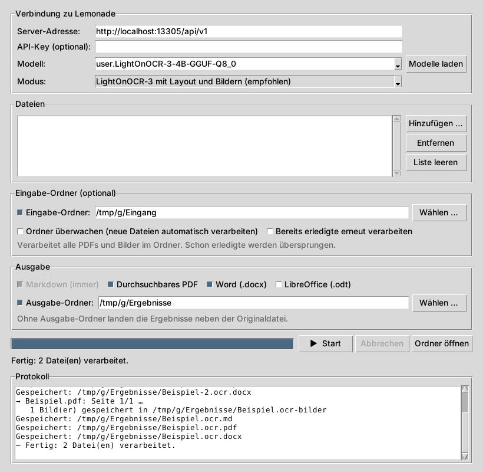

# local-lemon-ocr

Lokale Texterkennung (OCR) für PDFs und Bilder mit **LightOnOCR-3** über einen **[Lemonade Server](https://lemonade-server.ai/)**. Alles läuft auf dem eigenen Rechner, kein Dokument verlässt den PC.

- 📄 **Durchsuchbares PDF im Original-Layout:** Die Seiten bleiben unverändert sichtbar, darüber liegt eine unsichtbare Textebene, zeilengenau an der richtigen Stelle.
- 🖼️ **Bilderkennung:** Bilder, Logos und Diagramme werden ausgeschnitten und an ihrer Originalstelle eingefügt, mit Bildbeschreibung als Bildunterschrift.
- 📝 **Export** als Markdown, Word (`.docx`) und LibreOffice (`.odt`), mit echten Tabellen und Formeln
- 📂 **Eingabe- und Ausgabe-Ordner:** Alles verarbeiten, was im Eingabe-Ordner liegt, auf Wunsch laufend überwacht (Hotfolder). Erledigte Dateien werden übersprungen.
- 🛟 **Robust:** Scheitert eine Seite, geht es mit der nächsten weiter. Bei Abbruch bleibt das bisher Erkannte erhalten.
- 🖱️ **Grafische Oberfläche** für die Verarbeitung mehrerer Dateien, dazu eine Kommandozeile für Skripte



> Dieses Projekt ist ein unabhängiges Hilfsprogramm und steht in keiner Verbindung zu AMD, dem Lemonade-Projekt oder LightOn.

---

## Voraussetzungen

| | |
|---|---|
| Betriebssystem | Windows 11 (Linux funktioniert ebenfalls) |
| Grafikkarte | ab 8 GB VRAM, mit 16 GB läuft das 4B-Modell in bester Qualität |
| Software | [Lemonade](https://lemonade-server.ai/), Python ab 3.10, optional [Pandoc](https://pandoc.org/) für Word/LibreOffice |

## Installation

### 1. Lemonade und Modell

1. Lemonade von [lemonade-server.ai](https://lemonade-server.ai/) installieren und die App starten.
2. In der App unter **Models** nach `prithivMLmods/LightOnOCR-3-4B-GGUF` suchen. Unter „Included Components“ muss **Vision projector (MMProj)** stehen.
3. Variante **Q8_0** herunterladen.
4. In den **Modell-Einstellungen** eintragen:
   - llama.cpp-Argumente: `--reasoning off` (ältere Versionen: `--reasoning-format none`)
   - Kontextgröße: `16384`
5. Das Modell neu laden.

> **Warum `--reasoning off`?** LightOnOCR-3 basiert auf Qwen3.5, dessen Chat-Vorlage standardmäßig einen „Denkmodus“ einschaltet. Ohne die Einstellung landet der erkannte Text im Reasoning-Feld, und die Antwort bleibt leer: *„The model returned no visible answer“*.

Das kleinere `prithivMLmods/LightOnOCR-3-0.8B-GGUF` ist kaum schlechter und deutlich schneller, wenn du viele Seiten verarbeitest.

### 2. Python-Pakete

```powershell
winget install Python.Python.3.12
winget install JohnMacFarlane.Pandoc      # optional, für Word/LibreOffice
```

PowerShell danach neu öffnen, dann im Projektordner:

```powershell
pip install -r requirements.txt
```

## Benutzung

### Grafische Oberfläche

Doppelklick auf **`ocr_gui.pyw`** (oder `pythonw ocr_gui.pyw`). `ocr.py` muss im selben Ordner liegen.

1. Das Programm verbindet sich mit Lemonade und wählt automatisch ein OCR-Modell. Läuft der Server noch nicht, kannst du den Modellnamen auch eintippen.
2. Dateien hinzufügen. Du kannst sie auch direkt auf das Programmsymbol ziehen.
3. Oder einen **Eingabe-Ordner** ankreuzen: Dann werden alle PDFs und Bilder darin verarbeitet. Schon erledigte Dateien überspringt das Programm (außer mit „Bereits erledigte erneut verarbeiten“).
4. Mit **Ordner überwachen** prüft das Programm alle 10 Sekunden, ob neue Dateien dazugekommen sind, und verarbeitet sie, sobald sie fertig kopiert sind. **Abbrechen** beendet die Überwachung.
5. Optional einen **Ausgabe-Ordner** wählen, sonst landen die Ergebnisse neben der Originaldatei.
6. Ausgabeformate ankreuzen und **Start** klicken.

Die Einstellungen werden in `~/.ocr-gui.json` gespeichert, der API-Key bewusst nicht.

### Kommandozeile

```powershell
python ocr.py <Modell> [Datei ...] [-e EINGABE] [-o AUSGABE] [--ueberwachen] [-p PROMPT] [--pdf] [--docx] [--odt]
```

```powershell
python ocr.py user.LightOnOCR-3-4B-GGUF-Q8_0 scan.jpg
python ocr.py user.LightOnOCR-3-4B-GGUF-Q8_0 dokument.pdf --pdf --docx
python ocr.py user.LightOnOCR-3-4B-GGUF-Q8_0 a.pdf b.pdf -o Ergebnisse --pdf
python ocr.py user.LightOnOCR-3-4B-GGUF-Q8_0 -e Eingang -o Ergebnisse --pdf --ueberwachen
python ocr.py user.PaddleOCR-VL-1.6-GGUF scan.png -p "OCR:"
```

`python ocr.py --help` zeigt alle Optionen. Die alte Schreibweise mit dem Prompt als drittem Argument (`scan.png "OCR:"`) funktioniert weiterhin.

Den Modellnamen zeigt `lemonade list`. Kommt die Meldung „model not found“, lass das Präfix `user.` weg.

| Option | Ergebnis |
|---|---|
| *(immer)* | `name.ocr.md`: Text als Markdown, eine Überschrift pro Seite |
| *(bei Bildern)* | `name.ocr-bilder/`: ausgeschnittene Bilder als PNG mit 300 dpi |
| `--pdf` | `name.ocr.pdf`: durchsuchbares PDF im Original-Layout |
| `--docx` | `name.ocr.docx`: Word-Datei (braucht Pandoc) |
| `--odt` | `name.ocr.odt`: LibreOffice-Datei (braucht Pandoc) |
| `-p PROMPT` | Ohne Angabe gilt der `grounding`-Modus von LightOnOCR-3 mit Positionen und Bildern. `""` liefert nur Text. Für PaddleOCR-VL: `"OCR:"` oder `"Table Recognition:"` |
| `-e ORDNER` | Eingabe-Ordner: alle PDFs und Bilder darin verarbeiten (ohne Unterordner). Bereits erledigte Dateien werden übersprungen |
| `-o ORDNER` | Ausgabe-Ordner. Ohne Angabe landen die Ergebnisse neben der Originaldatei |
| `--ueberwachen` | Eingabe-Ordner laufend auf neue Dateien prüfen, beenden mit Strg+C. Prüfabstand mit `--intervall SEK` (Standard 10) |
| `--alle` | Im Eingabe-Ordner auch bereits erledigte Dateien neu verarbeiten |
| `--url URL` | Server-Adresse, falls nicht `http://localhost:13305/api/v1` |

**Gleiche Dateinamen:** Kommen in einem Durchlauf zwei Dateien mit demselben Namen vor (z. B. `Beispiel.pdf` und `Beispiel.png`), bekommt die zweite die Endung bzw. eine Nummer angehängt: `Beispiel-png.ocr.md`, `Beispiel-2.ocr.md`.

**Als erledigt** gilt eine Datei, wenn im Ausgabe-Ordner schon ein vollständiges `name.ocr.md` liegt, das neuer ist als die Datei. Teilergebnisse werden beim nächsten Lauf neu verarbeitet.

Der Rückgabewert ist 0, wenn alles geklappt hat, 1 bei Fehlern und 130 nach Strg+C.

### Konfiguration

| Was | Wo |
|---|---|
| Server-Adresse | Umgebungsvariable `LEMONADE_BASE_URL`, Option `--url` bzw. in der Oberfläche (Standard `http://localhost:13305/api/v1`) |
| API-Key | Umgebungsvariable `LEMONADE_API_KEY` bzw. in der Oberfläche |
| Auflösung für das Modell | `MAX_KANTE` in `ocr.py` (Standard 2048 px, wie von LightOn empfohlen) |
| Auflösung der Bilder | `BILD_DPI` in `ocr.py` (Standard 300) |

## So funktioniert es

1. Jede Seite wird so gerendert, dass die längste Kante 2048 px misst, und über die OpenAI-kompatible Schnittstelle an Lemonade geschickt.
2. LightOnOCR-3 antwortet im `grounding`-Modus mit Blöcken der Form `` und dem Inhalt. Die Koordinaten sind auf 0–1000 normiert.
3. **Textebene:** In jeder Box sucht das Skript die tatsächlichen Textzeilen im Bild, über das Helligkeitsprofil. Jede Zeile wird als unsichtbarer Text (`render_mode=3`) auf genau ihre Breite und Höhe gelegt.
4. **Bilder:** Boxen vom Typ `image` oder `chart` werden ausgeschnitten, gespeichert, im PDF als eigenes Bildobjekt an die Originalstelle gelegt und in Markdown/Word/LibreOffice eingefügt.
5. **Fehler und Abbruch:** Jede Anfrage wird bei Zeitüberschreitung oder Serverfehler automatisch bis zu zweimal wiederholt. Scheitert eine Seite trotzdem, steht im Markdown an ihrer Stelle `[FEHLER: Seite nicht erkannt …]`, und es geht mit der nächsten Seite weiter. Bei Abbruch oder wenn der Server ganz wegfällt, werden die fertigen Seiten trotzdem gespeichert, markiert mit `[UNVOLLSTÄNDIG …]`.
6. **PDFs mit vorhandenem Text** (digitale PDFs oder schon per OCR bearbeitet) bekommen keine zweite Textebene, sonst gäbe es doppelte Suchtreffer.
7. **Gedrehte Seiten** (`/Rotate` im PDF) werden so erkannt, wie sie angezeigt werden. Textebene und Bilder werden passend zurückgedreht.
8. **Office-Export:** Markdown → HTML → DOCX/ODT über Pandoc. Der Umweg über HTML erhält HTML-Tabellen, und mit `--mathml` werden LaTeX-Formeln zu bearbeitbaren Office-Formeln.

## Anbindung an Paperless-ngx (optional)

Es gibt zwei Wege:

- **Einfach:** Durchsuchbare PDFs mit `--pdf` erzeugen und in den Eingangsordner (consume) von Paperless legen. Mit `PAPERLESS_OCR_MODE: skip` übernimmt Paperless die vorhandene Textebene.
- **Automatisch:** Über [paperless-gpt](https://github.com/icereed/paperless-gpt) mit `VISION_LLM_PROVIDER: openai` und `OPENAI_BASE_URL` auf den Lemonade-Server. Dafür muss Lemonade im Netzwerk erreichbar sein (`lemonade config set host=0.0.0.0`, API-Key setzen, Firewall nur für den Server öffnen).

Details stehen in der [ausführlichen Anleitung](docs/Anleitung.docx).

## Fehlerbehebung

| Problem | Lösung |
|---|---|
| Connection refused | Lemonade-App starten, Port mit `lemonade config` prüfen |
| Fehler 401 | API-Key setzen: `$env:LEMONADE_API_KEY = "…"` |
| model not found | Modellnamen mit bzw. ohne `user.` versuchen |
| „returned no visible answer“ / leere Ausgabe | `--reasoning off` in den Modell-Einstellungen |
| `[WARNUNG: Ausgabe abgeschnitten]` | Kontextgröße erhöhen (16384 oder mehr) |
| Bild wird ignoriert | Modell ohne MMProj geladen, neu herunterladen |
| Bild abgeschnitten | in `ocr.py` den Wert `rand = 4` erhöhen |
| `✖ Seite N nicht erkannt` | Zeitüberschreitung oder Serverfehler bei dieser Seite. Die übrigen Seiten sind gespeichert. Datei später erneut verarbeiten (im Eingabe-Ordner passiert das beim nächsten Start automatisch) |
| `[UNVOLLSTÄNDIG: …]` im Ergebnis | Verarbeitung wurde abgebrochen oder die Verbindung ist abgerissen. Datei erneut verarbeiten |
| „enthielten schon Text – dort wurde keine zweite Textebene eingefügt“ | Hinweis, kein Fehler: Die PDF-Seite war schon durchsuchbar |
| `PDF ist passwortgeschützt` | PDF zuerst ohne Passwort speichern |
| `Pandoc-Fehler: …` | Die Meldung kommt direkt von Pandoc, meist ist Pandoc zu alt oder die Zieldatei ist noch in Word geöffnet |
| Datei im überwachten Ordner wird nicht verarbeitet | Sie wird erst genommen, wenn sie sich zwischen zwei Prüfungen nicht mehr ändert. Nach einem Fehler wird sie erst wieder versucht, wenn sie sich ändert oder das Programm neu startet |

## Grenzen

- Word/LibreOffice enthalten Text, Überschriften, Listen, Tabellen und Bilder, aber nicht das exakte Seitenlayout. Das bleibt nur im PDF erhalten.
- Positionen und Bilder gibt es nur mit LightOnOCR-3. Mit anderen Modellen liegt der Text als ein Block über der Seite.

## Tests

Die Tests brauchen keinen Lemonade Server: Statt `ocr.ocr` liefert eine Fake-Funktion eine feste grounding-Antwort mit absichtlich ungenauen Boxen. Geprüft wird unter anderem, ob die Wörter im durchsuchbaren PDF an der richtigen Stelle liegen (auch bei gedrehten Seiten).

```powershell
python -m unittest discover -s tests -v
```

Der GUI-Test läuft nur mit Display. Unter Linux headless: `xvfb-run python -m unittest discover -s tests -v`.

## Lizenz

[MIT](LICENSE). Die Modelle haben eigene Lizenzen: LightOnOCR-3 steht unter Apache 2.0.
